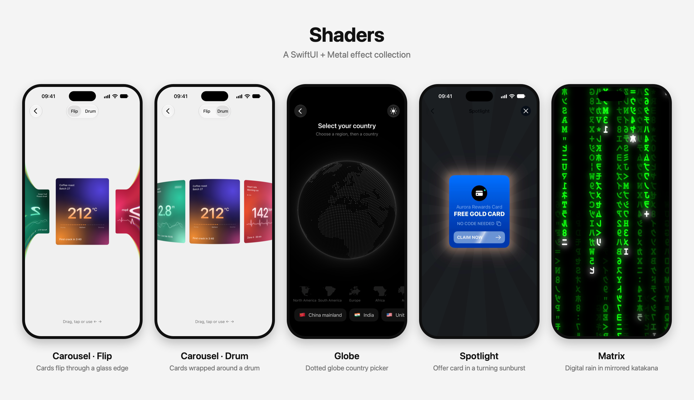

SwiftUI app with a collection of Metal shaders

## Effects

- **Carousel** – 3D cards refracted through a glass edge (flip and drum styles).
- **Globe** – a country picker over a dotted globe ray-cast in Metal. Pick a region to
  turn the globe to it and light it up, then a country (or tap one on the globe) to fly
  in and reveal it on a finer grid of dots.
- **Spotlight** – an offer card popping up over a dimmed screen, in a turning sunburst with
  a warm glow around it and a glint sweeping across its button.
- **Matrix** – digital rain across the whole screen, in any orientation: mirrored
  katakana, Latin capitals, digits and symbols falling in streams with white heads and
  green trails, some columns far back and soft. The glow is a Gaussian measured from a
  reference still. Tap to hide the bars.

Country shapes come from [Natural Earth](https://www.naturalearthdata.com) (public
domain), baked into a country-ID map by `Tools/BakeCountryMap.swift`.
